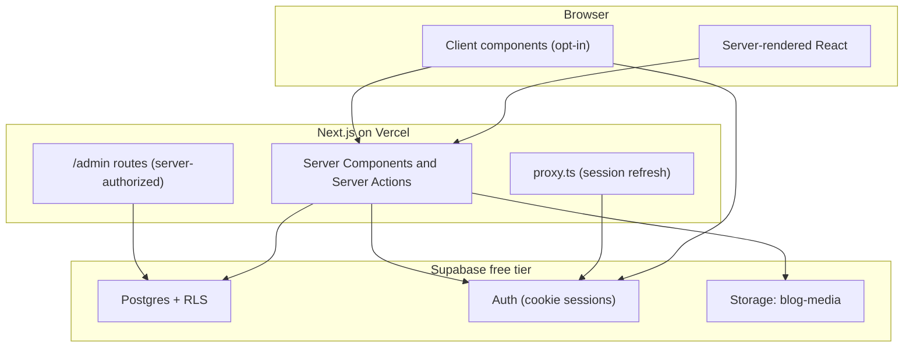
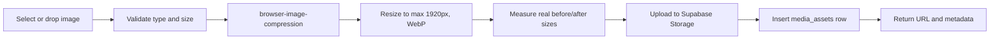

# Architecture

## Goals

A premium editorial publication that is fully dynamic, secure by default, fast on the first byte, and maintainable by one developer. Content, media, taxonomy, comments, subscribers and analytics are all manageable from a server-authorized admin panel.

## System boundaries

Three trust zones:

1. **Public** — read-only access to published content via RLS-allowed `select` policies.
2. **Authenticated admin** — user-scoped Supabase client plus a server-side role check on every protected route and mutation.
3. **Privileged server** — service-role client, only imported by modules marked `server-only`, used for provisioning and maintenance.

## Rendering and caching strategy

- **Server Components by default.** Client components are pulled in only for interactive islands: theme toggle, mobile navigation, editor, uploader, media picker.
- **Public reads are cached.** Post and taxonomy queries are wrapped in `use cache` with explicit `cacheLife` and `cacheTag`.
- **Writes invalidate on demand.** Admin mutations call helpers in `src/lib/cache` (`revalidateTag(..., "max")` or `updateTag` for read-your-writes).
- **Authenticated data is never publicly cached.** Admin routes and session reads stay dynamic; the proxy sets private cache headers when it rotates tokens.
- **Streaming over blocking.** Uncached or request-dependent sections sit behind `<Suspense>` with skeletons instead of blocking the route.

Next.js 16 with Cache Components changes the rules versus earlier versions: `GET` route handlers follow the same prerendering model as pages, and reading `cookies()` or `headers()` outside a Suspense boundary is a build error. Phase 4 queries and Phase 5 session reads are written with that constraint in mind.

## Data flow

### Read path (public)

1. Server Component calls a typed query function in `src/lib/queries/*`.
2. The function is a `"use cache"` scope. It uses the cookie-less anon client in `src/lib/supabase/public.ts` (never `cookies()` / `headers()`).
3. RLS restricts rows to `published` posts whose `published_at` has passed.
4. Results are tagged (`posts`, `post:<slug>`, `categories`, `tags`, `authors`) with `cacheLife('hours'|'days')`.
5. The component renders; the static shell was already served from the edge.

### Write path (admin)

1. A Server Action validates input with Zod.
2. It re-reads the Supabase session (`auth.getUser()`) and verifies the caller's `profiles.role` via `requireStaff` / `requireAdmin`.
3. The mutation runs through the user-scoped client so RLS applies, or through the service-role client for operations RLS cannot express safely.
4. `revalidateTag` invalidates affected public caches.
5. The action returns a typed result; the UI updates optimistically where it helps.

### Auth path (staff)

1. `/admin` posts email and password to the `signIn` Server Action.
2. Supabase Auth sets http-only cookies through `@supabase/ssr`.
3. The action loads `profiles.role`. Non-staff sessions are signed out immediately.
4. `src/app/admin/(panel)/layout.tsx` calls `requireStaff()` on every newsroom render. Cookie reads sit behind `<Suspense>`.
5. `src/proxy.ts` rotates tokens and marks `/admin` responses `private, no-store`.

## Database

Thirteen tables, all with RLS enabled:

`profiles`, `posts`, `categories`, `tags`, `post_tags`, `media_assets`, `comments`, `subscribers`, `bookmarks`, `post_likes`, `post_views`, `site_settings`, `contact_messages`.

Key decisions:

- Article bodies are stored as structured Tiptap JSON (`jsonb`), never as trusted raw HTML.
- Slugs are unique per table and validated on write.
- Publication eligibility is derived: `status = 'published'` **and** `published_at <= now()`. Scheduling is not a client-side label.
- `media_assets` records both original and optimised file sizes so compression statistics reflect real numbers.
- Deletion of categories, tags and media is blocked or warned when references exist, rather than silently orphaning content.

Full DDL, indexes, triggers and policies live in `supabase/migrations`. Setup and admin provisioning are in `docs/SUPABASE.md`.

## Media pipeline

The same uploader component powers the media library, the editor, cover selection and category images. Compression statistics are computed from actual files — never mocked.

## Internationalisation readiness

Copy lives in components for now, but routes, metadata and formatting go through central helpers (`src/lib/seo.ts`, `src/lib/format.ts`) so a locale segment and translation layer can be introduced without rewriting pages.

## Why these choices

- **Supabase over a bespoke backend**: Postgres, auth, storage and RLS in one free-tier service removes four moving parts and keeps authorization declarative.
- **shadcn/ui over a component library**: components are copied into the repo, so the editorial visual identity is not fighting a vendor theme, and accessibility primitives come from Base UI.
- **Structured JSON over HTML**: prevents stored XSS as a class of bug, enables a table of contents generated from document structure, and keeps the rendering surface small.
- **Server Actions over a separate API**: fewer moving parts, typed end to end, and no hand-written fetch layer to keep in sync.
